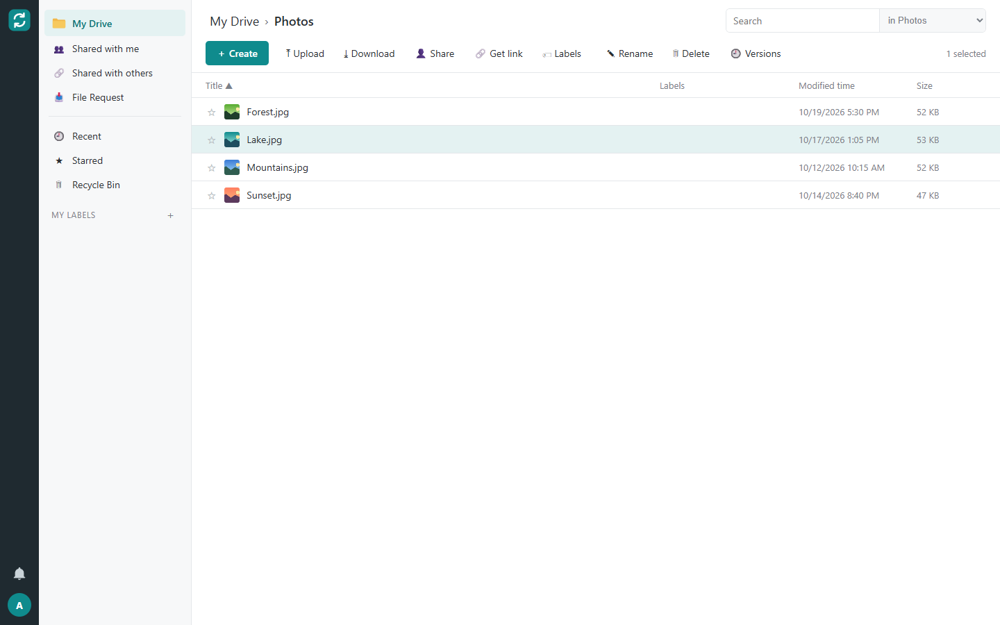
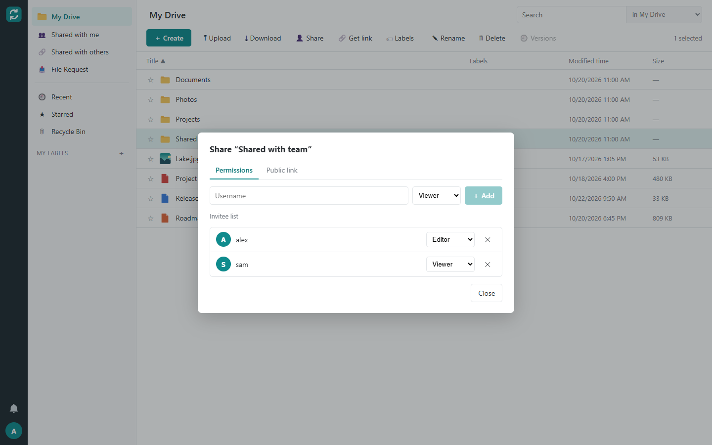
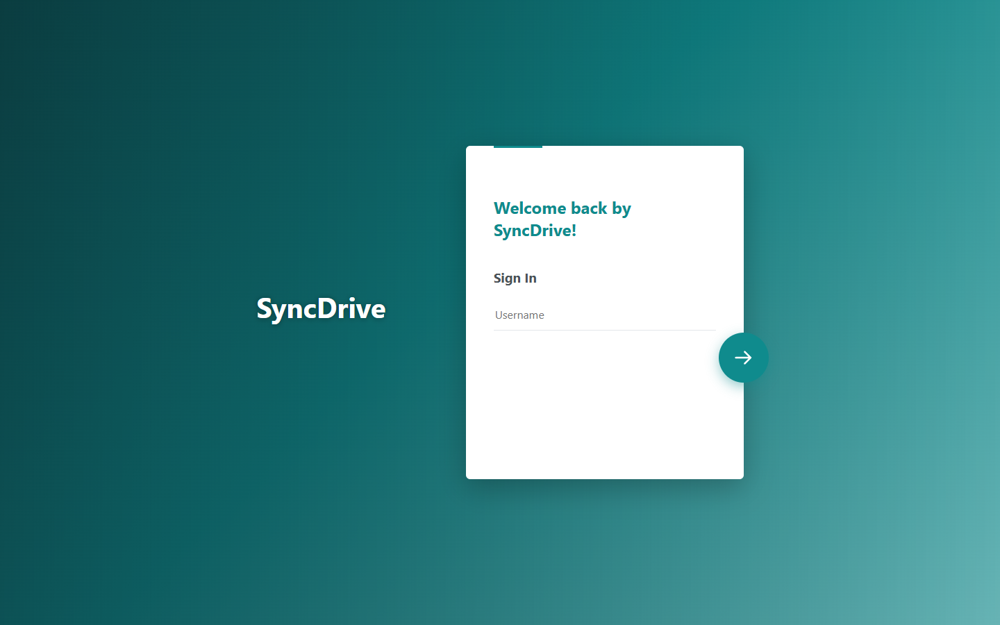

<p align="center">
  
</p>

<h1 align="center">SyncDrive</h1>

<p align="center">
  Self-hosted file sync and share — your files on your own server, in sync on every device.
</p>

<p align="center">
  <a href="https://github.com/MAGPEEK/SyncDrive/actions/workflows/ci.yml"></a>
  <a href="https://github.com/MAGPEEK/SyncDrive/releases"></a>
  <a href="https://hub.docker.com/r/magpeek/syncdrive-server"></a>
  <a href="LICENSE"></a>
</p>

---

## Introduction

SyncDrive is an open-source file synchronization and sharing system that you run on your own hardware. A small server in a
Linux container keeps your files; a Windows client keeps local folders in sync with it; a web interface gives you access from
any browser. Your data never leaves your server.

SyncDrive is built for homes and small teams who want the comfort of a cloud drive without handing their files to a cloud
provider: a NAS, a mini PC or a small VPS is all it takes.

With SyncDrive you can

- **sync folders** between your PCs and the server — two-way, upload-only (backup) or download-only, with as many sync tasks as you like;
- **keep files online-only** and download them on demand when you open them, so a laptop can see terabytes without storing them
  (Windows Cloud Files, with status icons and "Always keep on this device" / "Free up space" in Explorer);
- **work from Explorer**: status icons, a SyncDrive context menu, browse and restore previous versions, lock files while you edit them;
- **use the web interface**: browse, upload by drag & drop, download files or whole folders as ZIP, search, recently changed files,
  recycle bin, versions, starred files, labels, notifications and image previews;
- **share** folders with other users (viewer, editor, manager …), create **public links** with password and expiry date, and
  collect files from anyone with **file requests**;
- **work in teams** with groups and team folders that belong to the organization rather than one person;
- **administer** users, storage quotas, groups, team folders, sharing policies and the sign-in page from the browser;
- **sleep well**: every change creates a version, deleted files go to a recycle bin, conflicts are kept side by side, and the server
  backs itself up every night.

## Screenshots

<p align="center">
  <br>
  <em>Web interface: files with image previews, categories, labels and the action bar</em>
</p>

<p align="center">
  
  <br>
  <em>Sharing a folder with roles · sign-in page with your own server name and background</em>
</p>

## Components

| Component | What it is | Runs on |
|---|---|---|
| **SyncDrive Server** | REST API, sync engine, block store (SQLite + files), web interface, daily backup | Linux container (Docker, Podman, any NAS with Docker) |
| **SyncDrive Client** | Tray app, background service and Explorer integration; `syncdrive_cli` for scripts | Windows 10 (2004+) / Windows 11, x64 |
| **Web interface** | Blazor WebAssembly app served by the server under `/` | Any current browser |

## Getting started

### 1. Set up the server with Docker

You need Docker with the Compose plugin on a Linux machine (or a NAS with Docker support). The server image is published on
Docker Hub as **[`magpeek/syncdrive-server`](https://hub.docker.com/r/magpeek/syncdrive-server)** (`linux/amd64`, `linux/arm64`;
tags `latest` and `<version>`).

**Try it in one minute** (local test without TLS):

```bash
docker run -d --name syncdrive -p 127.0.0.1:8080:8080 -v syncdrive-data:/data \
  -e SYNCDRIVE_Server__RequireTls=false \
  -e SYNCDRIVE_Server__AdminUserName=admin -e SYNCDRIVE_Server__AdminPassword='change-me-now' \
  magpeek/syncdrive-server:latest
```

Open `http://localhost:8080/` and sign in as `admin`.

**Production setup with Docker Compose:** the server plus a [Caddy](https://caddyserver.com/) reverse proxy that terminates TLS on
port **8443**. Copy the example folder **[`docker/`](docker)** (`docker-compose.yml`, `Caddyfile`, `.env.example`) to the
server, then:

```bash
cp .env.example .env && nano .env                              # SYNCDRIVE_HOST: the name clients use to reach the server
printf '%s' 'a-long-admin-password' > admin-password.txt       # read once on the first start
sudo chown 1654:1654 admin-password.txt && sudo chmod 400 admin-password.txt
docker compose up -d
```

Open `https://drive.example.lan:8443/` and sign in as `admin`. By default Caddy issues a certificate from its own internal CA; the
client shows its fingerprint on first connect and asks you to trust it.

Data lives in the Docker volume `syncdrive-data`, nightly backups in `syncdrive-backup`. The full guide, with `docker run` behind
your own reverse proxy, all configuration variables, backup, updates and troubleshooting, is in **[docs/server.md](docs/server.md)**.

### 2. Install the Windows client

Download the latest version from the **[Releases page](https://github.com/MAGPEEK/SyncDrive/releases/latest)**:

| Download | Use it for |
|---|---|
| `SyncDrive-Client-<version>-<build>-x64.exe` | Setup program — double-click and follow the wizard (recommended) |
| `SyncDrive-Client-<version>-<build>-x64.msi` | Windows Installer package — for silent installs and software distribution (Intune, GPO, scripts) |
| `SyncDrive-Client-<version>-<build>-x64.sha256` | SHA-256 checksums of both files |

The client installs per user into `%LOCALAPPDATA%\Programs\SyncDrive` and needs **no administrator rights**. It brings its own .NET
runtime. After installation the setup wizard opens: enter the server address (e.g. `drive.example.lan:8443`), your user name and
password, then choose a server folder and a local folder to sync.

Silent installation:

```powershell
msiexec /i SyncDrive-Client-<version>-<build>-x64.msi /qn LAUNCHAPP=0
```

Details, uninstalling and the command line are in **[docs/client.md](docs/client.md)**.

### 3. Command line: `syncdrive_cli`

The installer puts `syncdrive_cli.exe` on your `PATH`. It talks to the same background service as the tray app:

```text
syncdrive_cli connect drive.example.lan -u alice      # sign in (asks for the password)
syncdrive_cli ls                                       # list your spaces
syncdrive_cli sync D:\Projects -s sp_1234 -p Projects  # sync a server folder to a local folder
syncdrive_cli status                                   # state of all sync tasks
syncdrive_cli pause | resume [task-id]
syncdrive_cli desync D:\Projects                       # stop syncing (local files stay)
```

Exit codes: `0` success, `1` failure, `2` wrong usage — handy for scripts.

## Features in detail

**Sync engine**
- Content-defined chunking (FastCDC, 256 KiB – 4 MiB blocks): only changed blocks travel, identical content is stored once.
- Live updates through long polling; changes on the server reach clients within seconds.
- Rename and move detection, conflict copies that keep both versions, local recycle bin for files deleted by sync.
- Filters for temporary files, maximum file size and path length, per-task folder selection.

**Server**
- Single process with embedded SQLite (WAL) and a content-addressed block store — no separate database or cache container needed.
- Versions (10 per file by default), recycle bin, file locking, favorites, labels, notifications, image thumbnails.
- Sharing with roles (Previewer, Viewer, Editor, Manager, Owner), public links, file requests, groups, team folders, sharing policies.
- Admin console: users, quotas (`507` when exceeded), password resets, device management.
- Nightly consistent backup (`VACUUM INTO` + incremental blocks), health endpoint, hardened container (read-only, no capabilities).

**Security**
- Passwords hashed with Argon2id; per-device tokens stored only as hashes and revocable from the web interface.
- TLS required (directly or behind a proxy); clients can pin self-signed certificates.
- Brute-force protection for sign-in and link passwords (`429` with `Retry-After`).
- Blocks are scoped per space: knowing a hash never gives access to someone else's file.

## Building from source

Requirements: [.NET SDK 9](https://dotnet.microsoft.com/download), Docker for the server image, Windows for the client packages.

```bash
dotnet build
dotnet test                              # ~2,500 tests, run on Linux and Windows in CI
docker build -t syncdrive-server .       # server image incl. web interface
pwsh installer/build-client.ps1          # Windows: client .msi and .exe into artifacts/client
```

| Project | Purpose |
|---|---|
| `src/SyncDrive.Core` | Domain logic without dependencies: paths, hashes, merge, filters, conflict names, FastCDC |
| `src/SyncDrive.Contracts` | Protocol DTOs and error codes |
| `src/SyncDrive.Server.*` | Server application services and ASP.NET Core host |
| `src/SyncDrive.Client.*` | Sync engine, background service (daemon), tray UI (Avalonia), `syncdrive_cli` |
| `src/SyncDrive.Web*` | Web interface (Blazor WebAssembly) and its view models |
| `src/SyncDrive.Infra.*` | Adapters: SQLite, block files, Argon2, HTTP, named pipes, Windows Cloud Files, thumbnails |
| `tests/` | Unit, contract, scenario, end-to-end and architecture tests |
| `docker/` | Docker Compose example with the Docker Hub image (deploy without source code) |
| `deploy/` | Same stack built from source, with resource limits and log rotation |
| `installer/` | WiX 5 projects and build script for the Windows packages |

The architecture is hexagonal: the core knows nothing about databases, HTTP or Windows; architecture tests enforce the dependency rules.

## Versioning

SyncDrive follows [Semantic Versioning](https://semver.org/). Until 1.0.0 the protocol may still change between minor versions.
See [CHANGELOG.md](CHANGELOG.md) for what changed in each release.

## License

SyncDrive is released under the [MIT License](LICENSE).
